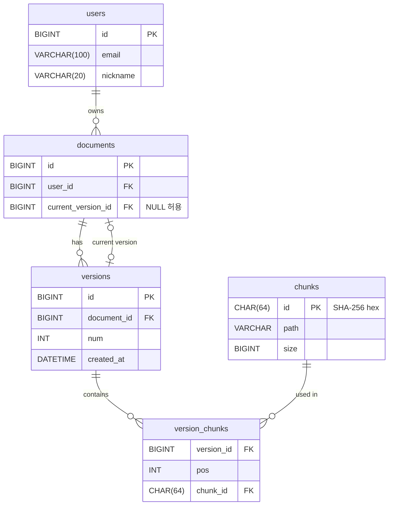

# ERD

## 테이블

### users

| 컬럼 | 타입 | 제약 |
|---|---|---|
| id | BIGINT | PK |
| email | VARCHAR(100) | NOT NULL |
| nickname | VARCHAR(20) | NOT NULL |

### documents

| 컬럼 | 타입 | 제약 |
|---|---|---|
| id | BIGINT | PK |
| user_id | BIGINT | FK → users.id, NOT NULL |
| current_version_id | BIGINT | FK → versions.id, **NULL 허용** |

### versions

| 컬럼 | 타입 | 제약 |
|---|---|---|
| id | BIGINT | PK |
| document_id | BIGINT | FK → documents.id, NOT NULL |
| num | INT | NOT NULL |
| created_at | DATETIME | NOT NULL |

- UNIQUE(document_id, num)

### chunks

| 컬럼 | 타입 | 제약 |
|---|---|---|
| id | CHAR(64) | PK, 내용의 SHA-256 (16진수) |
| path | VARCHAR | NOT NULL, 파일/S3 위치 |
| size | BIGINT | NOT NULL |

### version_chunks

| 컬럼 | 타입 | 제약 |
|---|---|---|
| version_id | BIGINT | FK → versions.id, NOT NULL |
| pos | INT | NOT NULL |
| chunk_id | CHAR(64) | FK → chunks.id, NOT NULL |

- UNIQUE(version_id, pos)

## 관계

- users 1 : N documents
- documents 1 : N versions
- documents → versions: `current_version_id`로 현재 버전 하나를 가리킴
- versions N : M chunks (연결 테이블 `version_chunks`)

## 설계 이유

- **버전은 불변.** 수정하면 기존 버전은 그대로 두고 새 버전을 만든다. 복원은 `current_version_id`를 예전 버전으로 바꾸는 것.
- **순서는 `pos` 정수.** 버전이 불변이라 중간 삽입 때 번호를 밀 일이 없다. `ORDER BY pos`로 읽고, 범위 조회로 이어 받기가 된다. 연결 리스트는 한 버전에 같은 청크가 두 번 나오면 표현이 안 돼서 버렸다.
- **청크 ID는 내용 해시.** 같은 내용은 한 번만 저장하고, 업로드 전에 해시로 서버에 있는지 확인한다. 서버는 받은 청크의 해시를 다시 계산해서 검증한다.
- **청크 데이터는 DB 밖에.** DB에는 경로와 크기만 둔다.
- **versions는 대리 키 + UNIQUE.** 참조하는 쪽 FK가 한 컬럼이 되고, JPA 매핑이 쉽다. 같은 문서에 같은 버전 번호가 두 개 생기는 건 UNIQUE가 막는다.
- **`current_version_id`만 NULL 허용.** documents와 versions가 서로를 가리켜서, 새 문서는 NULL로 먼저 만들고 → 버전 추가 → current 업데이트. 세 단계를 한 트랜잭션으로 묶는다.

## 아직 안 정한 것

- version_chunks의 PK: `(version_id, pos)` 복합 PK로 할지, 대리 키 `id`를 둘지
- users: email UNIQUE 여부, 로그인용 컬럼(비밀번호 해시 등)
- documents: 제목이나 경로 같은 메타데이터 컬럼
- 각 테이블의 생성/수정 시간 컬럼
