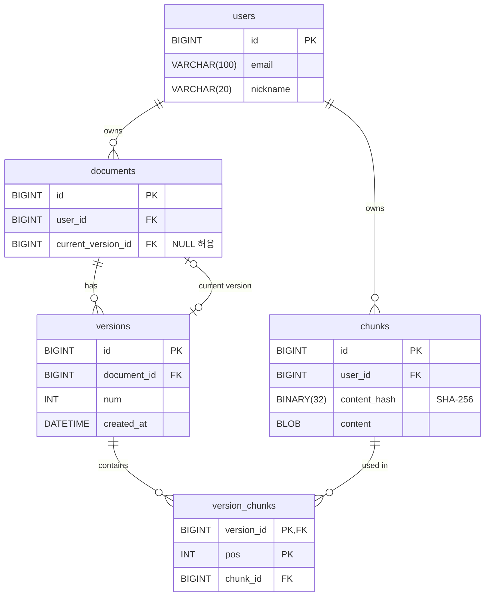

# ERD

## 테이블

### users

| 컬럼 | 타입 | 제약 |
|---|---|---|
| id | BIGINT | PK |
| email | VARCHAR(100) | NOT NULL |
| nickname | VARCHAR(20) | NOT NULL |

### documents

| 컬럼 | 타입 | 제약 |
|---|---|---|
| id | BIGINT | PK |
| user_id | BIGINT | FK → users.id, NOT NULL |
| current_version_id | BIGINT | FK → versions.id, **NULL 허용** |

### versions

| 컬럼 | 타입 | 제약 |
|---|---|---|
| id | BIGINT | PK |
| document_id | BIGINT | FK → documents.id, NOT NULL |
| num | INT | NOT NULL |
| created_at | DATETIME | NOT NULL |

- UNIQUE(document_id, num)

### chunks

| 컬럼 | 타입 | 제약 |
|---|---|---|
| id | BIGINT | PK |
| user_id | BIGINT | FK → users.id, NOT NULL |
| content_hash | BINARY(32) | NOT NULL, 내용의 SHA-256 |
| content | BLOB | NOT NULL, 최대 65,535바이트 |

- UNIQUE(user_id, content_hash)

### version_chunks

| 컬럼 | 타입 | 제약 |
|---|---|---|
| version_id | BIGINT | PK, FK → versions.id |
| pos | INT | PK |
| chunk_id | BIGINT | FK → chunks.id, NOT NULL |

## 관계

- users 1 : N documents
- documents 1 : N versions
- documents → versions: `current_version_id`로 현재 버전 하나를 가리킴
- users 1 : N chunks
- versions N : M chunks (연결 테이블 `version_chunks`)

## 설계 이유

- **버전은 불변.** 수정하면 기존 버전은 그대로 두고 새 버전을 만든다. 복원은 `current_version_id`를 예전 버전으로 바꾸는 것.
- **순서는 `pos` 정수.** 버전이 불변이라 중간 삽입 때 번호를 밀 일이 없다. `ORDER BY pos`로 읽고, 범위 조회로 이어 받기가 된다. 연결 리스트는 한 버전에 같은 청크가 두 번 나오면 표현이 안 돼서 버렸다.
- **청크는 사용자별로 내용 해시당 하나.** 서버가 내용을 잘라 해시를 계산하고, 같은 사용자의 같은 내용은 한 번만 저장한다. 클라이언트가 전체 내용을 보내므로 절약되는 것은 저장 공간뿐이다.
- **청크 내용은 DB에.** 측정한 청크 중앙값이 183바이트라 작은 파일을 많이 만드는 비용이 크고, 버전과 한 트랜잭션으로 묶으면 고아 청크와 청소 작업이 없다.
- **`BLOB`과 최대 65,535바이트.** 긴 문단은 바이트로 자르므로 글자가 끊길 수 있어 텍스트 타입을 쓸 수 없다. 넘치는 값은 DB가 오류로 막는다.
- **chunks는 대리 키 + UNIQUE.** `version_chunks`가 가장 많이 쌓이는 테이블이라 참조를 8바이트로 줄인다.
- **versions는 대리 키 + UNIQUE.** 참조하는 쪽 FK가 한 컬럼이 되고, JPA 매핑이 쉽다. 같은 문서에 같은 버전 번호가 두 개 생기는 건 UNIQUE가 막는다.
- **`current_version_id`만 NULL 허용.** documents와 versions가 서로를 가리켜서, 새 문서는 NULL로 먼저 만들고 → 버전 추가 → current 업데이트. 세 단계를 한 트랜잭션으로 묶는다.

## 아직 안 정한 것

- users: email UNIQUE 여부, 로그인용 컬럼(비밀번호 해시 등)
- documents: 제목이나 경로 같은 메타데이터 컬럼
- 각 테이블의 생성/수정 시간 컬럼
